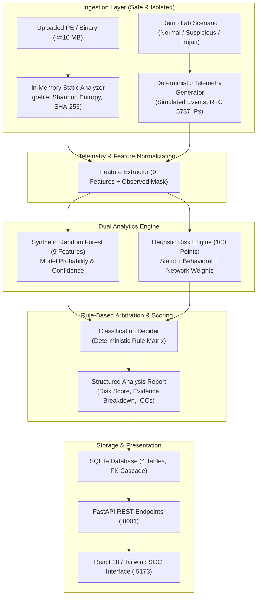

# TrojanGuard: AI-Powered Trojan Detection, Prediction & Behavioral Analysis System

[](tests/)
[](frontend/)
[](docs/ARCHITECTURE.md)
[](LICENSE)

> **Academic Demonstration & Prototype Disclaimer**  
> TrojanGuard is an educational and defensive cybersecurity prototype designed to demonstrate malware telemetry interpretation, explainable risk scoring, and machine learning evaluation principles.  
> **It contains zero offensive capabilities, does not execute uploaded files, does not contact live command-and-control servers, and does not dump memory from live endpoints.**

---

## 1. Abstract

Modern stealth malware, particularly Trojan horses, evades traditional signature-based antivirus detection by disguising malicious payload delivery behind legitimate executables and delaying host activity. **TrojanGuard** is a defensive security workbench that bridges static PE parsing, simulated behavioral/network telemetry, transparent heuristic risk scoring, and dual machine learning architectures. Rather than acting as a black-box detector, TrojanGuard pairs a transparent 100-point heuristic risk engine with an explainable Random Forest classifier, producing itemized evidence breakdowns, rule-trigger audit trails, and synthetic Indicators of Compromise (IOCs). Additionally, TrojanGuard features a research console evaluating real-world memory forensics on the benchmark **CIC-MalMem-2022** dataset across multi-regime validation splits and robustness ablations.

---

## 2. Problem Statement

Signature-based antivirus engines rely on known cryptographic hashes and byte sequences. Trojan authors routinely bypass these mechanisms through polymorphic packing, string encryption, and legitimate-looking file icons. Dynamic behavioral sandboxes analyze run-time activity but are computationally expensive, resource-intensive, and prone to evasion via sandbox detection sleeps. Furthermore, deep-learning and black-box AI approaches often fail to provide actionable defensive explanations, leaving Security Operations Center (SOC) analysts with opaque scores and high false-positive fatigue. There is a critical educational and operational need for a defensive workbench that illustrates how static, behavioral, and network signals fuse into explainable risk scores without endangering host infrastructure.

---

## 3. Objectives

1. **Safe Static Inspection**: Parse Portable Executable (PE) headers, section entropies, and import tables in-memory without disk execution or shell invocation.
2. **Deterministic Demonstration Simulation**: Simulate realistic multi-stage malware scenarios (Normal, Suspicious, Trojan-like) with sequential timestamped telemetry and RFC 5737 documentation IP ranges.
3. **Transparent Heuristic Risk Engine**: Implement an auditable 100-point risk score driven by explicit point allocations across static, behavioral, and network dimensions.
4. **Explainable Dual-ML Architecture**:
   - Demonstrate synthetic feature modeling (9 features) showing how ML classifiers evaluate host and network telemetry alongside rule overrides.
   - Train and evaluate a real-data memory forensics Random Forest on 38,711 records of **CIC-MalMem-2022** under rigorous grouped and leave-one-family-out cross-validation regimes.
5. **Ablation & Lab Artifact Auditing**: Uncover and document real-world ML evaluation traps, including virtual machine laboratory baseline artifacts (`svcscan.nservices`) and sample-group data leakage.
6. **Defensive SOC Dashboard**: Provide an intuitive web console offering detection timelines, threat distributions, network telemetry summaries, and historical record auditing.

---

## 4. Existing-System Limitations

| Dimension | Traditional Signature AV | Commercial Cloud Sandboxes | Opaque Neural Nets / Deep Learning | TrojanGuard (Proposed) |
|---|---|---|---|---|
| **Novel / Packed Trojans** | Fails on zero-day / repacked binaries | Detects after execution completes | High variance on distribution shifts | Heuristics flag packed sections & entropy |
| **Execution Safety** | Low risk (static scanning) | High risk (executes binary in VM) | Variable | Zero execution risk (strictly in-memory) |
| **Explainability** | Opaque signature database | Long unstructured execution logs | Black-box latent embeddings | Itemized point-by-point evidence breakdown |
| **Offline Independence** | Requires constant cloud signature updates | Expensive virtualization infrastructure | Requires high-end GPU compute | Lightweight, self-contained local SQLite |
| **Methodology Honesty** | Marketing claims of 100% detection | High vendor lock-in | Overfitted benchmark claims | Honest lab disclaimers, ablations, & leak audits |

---

## 5. Proposed System Architecture

TrojanGuard integrates three analytical layers: a safe in-memory file analyzer, a deterministic multi-stage scenario simulator, and an explainable risk & classification engine.



---

## 6. Technology Stack

- **Backend**: Python 3.12, FastAPI, Uvicorn (ASGI), Pydantic v2.
- **File Parsing & ML**: `pefile` (PE headers/imports/sections), `scikit-learn` (Random Forest, GroupShuffleSplit), `numpy`, `pandas`, `joblib`.
- **Database**: SQLite 3 with Write-Ahead Logging (WAL), foreign key constraints enabled (`PRAGMA foreign_keys = ON`), indexed searches.
- **Frontend**: React 18, Vite 6, Tailwind CSS, Lucide React icons.
- **Package Management & Tooling**: `uv` (fast Python virtual environments), `npm`.

---

## 7. Database Schema

TrojanGuard stores analyses in an embedded SQLite database (`backend/trojanguard.db`) structured across exactly four normalized tables:

```
+--------------------------------------------------------------------------+
|                                analyses                                  |
+--------------------------------------------------------------------------+
| id (INTEGER PK AUTO)                                                     |
| filename (TEXT), sha256 (TEXT), file_size (INTEGER), file_type (TEXT)    |
| timestamp (TEXT ISO-8601 UTC)                                            |
| classification (TEXT: 'Benign' | 'Suspicious' | 'Trojan-like')           |
| confidence (REAL [0.0, 1.0] or NULL), risk_score (0-100), risk_level     |
| analysis_source (TEXT: 'upload' | 'demo' | 'seed_demo')                  |
| summary (TEXT), features_json (TEXT JSON)                                |
+--------------------------------------------------------------------------+
        | 1                     | 1                     | 1
        | N (ON DELETE CASCADE) | N (ON DELETE CASCADE) | N (ON DELETE CASCADE)
+-------------------+   +--------------------+   +-------------------------+
|  behavior_events  |   |   network_events   |   |          iocs           |
+-------------------+   +--------------------+   +-------------------------+
| id (INTEGER PK)   |   | id (INTEGER PK)    |   | id (INTEGER PK)         |
| analysis_id (FK)  |   | analysis_id (FK)   |   | analysis_id (FK)        |
| timestamp (TEXT)  |   | timestamp (TEXT)   |   | type (hash|ip|dom|port) |
| event_type (TEXT) |   | source / dest (IP) |   | value (TEXT)            |
| description (TEXT)|   | port / protocol    |   | is_simulated (INT = 1)  |
| severity (TEXT)   |   | event_type (TEXT)  |   +-------------------------+
| is_simulated (=1) |   | is_simulated (=1)  |
+-------------------+   +--------------------+
```

---

## 8. Detection and Risk-Scoring Methodology

TrojanGuard employs a **hybrid detection paradigm**: raw telemetry is scored via transparent additive weights, while classification is governed by deterministic safety rules. The machine learning classifier outputs an advisory prediction and confidence percentage; when the ML model disagrees with defensive rules, the deterministic rule wins and the reason is recorded.

### 8.1 100-Point Heuristic Risk Engine Weights

| Category | Signal / Feature | Max Points | Condition |
|---|---|:---:|---|
| **Static Analysis** | High Section Entropy | +10 | Any PE section entropy > 7.0 (indicates packing/encryption) |
| | Suspicious API Imports | +16 | Imports from `kernel32`, `advapi32`, `ntdll` matching process injection or credential access |
| | Suspicious PE Sections | +8 | Non-standard section names (e.g., `.upx`, `.themida`, `.vmp`) |
| **Behavioral Telemetry** | Process Spawning | +12 | Spawning untrusted processes (e.g., `cmd.exe /c`, `powershell -enc`) |
| | Persistence Mechanisms | +18 | Writing to Registry Run keys (`CurrentVersion\Run`) or Startup paths |
| | Process Memory Injection | +16 | Calling `VirtualAllocEx`, `WriteProcessMemory`, or `CreateRemoteThread` |
| **Network Telemetry** | Outbound C2 Beaconing | +12 | Periodic or beacon-like connections to RFC 5737 external IPs |
| | Unresolved / DGA DNS | +8 | Queries to non-existent domains or high-entropy hostnames |
| **Total Available** | | **100 pts** | Clamped at 100 max |

### 8.2 Severity Thresholds
- **Low Risk**: 0–29 points
- **Medium Risk**: 30–59 points
- **High Risk**: 60–79 points
- **Critical Risk**: 80–100 points

### 8.3 Classification Rule Table

| Priority | Classification | Condition / Rule | Rule Description |
|:---:|---|---|---|
| **1** | **Trojan-like** | `risk_score >= 80` OR (`persistence >= 1` AND `c2_beacon >= 1`) | High risk score or dual evidence of persistence and external beaconing |
| **2** | **Suspicious** | `risk_score >= 40` OR `suspicious_imports >= 3` OR `entropy > 7.0` | Moderate risk score or packing indicators or multiple suspicious imports |
| **3** | **Benign** | All other cases | Minimal or no suspicious signals detected |
| **Safety** | **Upload Constraint** | Unobserved Behavioral/Network Telemetry | For file uploads without dynamic execution, classification cannot exceed **Suspicious** |

---

## 9. Data and Model Honesty

Academic transparency is a core design requirement of TrojanGuard. We explicitly document dataset provenance, evaluation boundaries, and laboratory artifacts:

1. **Synthetic 9-Feature Model**:
   - The Random Forest model in `ml/model.pkl` is trained on synthetic feature vectors generated with seed 42.
   - **Academic Honesty Notice**: Its high accuracy on synthetic test sets demonstrates feature pipeline integration only; it says nothing about detection capability against real-world in-the-wild malware.
2. **Scripted Demo Scenarios**:
   - Demo Lab scenarios (`normal`, `suspicious`, `trojan`) generate scripted, reproducible sequences to guarantee deterministic demonstrations.
3. **Real-Data Model (CIC-MalMem-2022)**:
   - Trained on 38,711 memory forensics records extracted via Volatility from virtual machine memory dumps.
   - **Upload Limitation**: Real-data memory features (e.g., `handles.nhandles`, `malfind.ninjections`, `svcscan.nservices`) **cannot be extracted from uploaded files by this application**. The app does not run a hypervisor or memory dumper.
   - **Suspicious as a Probability Band**: In binary classification, real malware is either Benign or Trojan. In TrojanGuard, the "Suspicious" classification represents a calibrated confidence uncertainty band:
     - `[0.00, 0.35)` = Benign
     - `[0.35, 0.65]` = Suspicious (Uncertain / Borderline)
     - `(0.65, 1.00]` = Trojan-like
4. **Evaluation Boundaries & Laboratory Artifacts**:
   - **Evaluation A (Random Stratified 80/20)**: Naive baseline. Overly optimistic because multiple memory dumps of the same malware sample land in both train and test partitions.
   - **Evaluation B (Grouped by `sample_hash`)**: Uses `GroupShuffleSplit` (seed 42) so that all memory dumps of a given Trojan sample remain strictly on one side of the split.
   - **Evaluation C (Leave-One-Family-Out Cross-Validation)**: Iteratively trains on 4 Trojan families + 80% Benign and tests on the held-out family + 20% Benign.
   - **Lab Environment Limitation**: Evaluations B and C measure performance on unseen samples and families **from the same laboratory virtual machine environment**, not proof of real-world generalization. Benign records in CIC-MalMem-2022 lack sample IDs, so cross-split benign leakage cannot be ruled out.
   - **Artifact Discovery (`svcscan.nservices`)**: Analysis of the dataset revealed that Benign dumps consistently run ~394 services (Mean: 394.21, Std: 1.35) while Trojan dumps run ~388 services (Mean: 388.75, Std: 1.46). This persistent ~5.5-service delta is an artifact of the laboratory VM baseline configuration, not a universal law of malware behavior.
   - **Robustness Ablation Findings**: When all 6 `svcscan.*` features were stripped (Ablation 1), and when the top-5 most important features were stripped (Ablation 2), both models missed exactly **5 of 1,825 Trojan test samples** in Evaluation B. Audit confirmed that all 5 missed dumps belong to **a single Trojan sample** (`Trojan-Scar-940031d1f698ef92d0c76c762cb41bff` across runs 1, 6, 7, 8, 9) whose predicted probability fell from >99% to 0.37–0.48 without the VM service counts.

---

## 10. API Endpoints

The backend serves all intelligence via RESTful JSON over port 8001:

| Method | Endpoint | Description |
|---|---|---|
| `GET` | `/api/health` | System health check (database connection, table count, active ML model status). |
| `POST` | `/api/analyze` | Safely analyze uploaded PE/binary in-memory (multipart/form-data, max 10 MB). |
| `GET` | `/api/demo/scenarios` | Returns metadata, description, and duration for all 3 demo scenarios. |
| `POST` | `/api/demo/start` | Starts an asynchronous simulation scenario (`normal`, `suspicious`, `trojan`). |
| `GET` | `/api/demo/{demo_id}/events` | Polls timestamped simulated telemetry events for a running demo. |
| `GET` | `/api/analysis/{id}` | Retrieves full structured analysis report, raw points breakdown, and IOCs. |
| `GET` | `/api/history` | Paginated analysis history with search, risk level filter, and sorting. |
| `GET` | `/api/dashboard` | Aggregated dashboard statistics (totals, threat distribution, detection timeline). |
| `GET` | `/api/threats` | Filtered list of detected threats (Suspicious and Trojan-like analyses). |
| `GET` | `/api/iocs/{id}` | Returns extracted IOCs for a specific analysis record. |
| `GET` | `/api/model/real/metrics` | Returns CIC-MalMem-2022 multi-regime evaluation metrics and ablation tables. |
| `POST` | `/api/model/real/predict` | Runs inference against real-data RF model via JSON vector or single-row CSV. |

---

## 11. Installation and Execution

### 11.1 Prerequisites
- Linux OS (tested on Ubuntu 22.04 / Debian)
- Python 3.12 (managed via `uv`)
- Node.js >= 18 and `npm`

### 11.2 Backend Setup & Execution
```bash
# Clone the repository
git clone https://github.com/ShivamInnovates/TrojanGuard.git
cd TrojanGuard

# Set up Python virtual environment using uv
cd backend
uv venv --python 3.12 .venv
source .venv/bin/activate
uv pip install -r requirements.txt

# Start backend server on port 8001
uvicorn app.main:app --host 127.0.0.1 --port 8001
```

### 11.3 Frontend Setup & Execution
```bash
# In a separate terminal
cd TrojanGuard/frontend
npm install

# Start Vite dev server on port 5173
BACKEND_PORT=8001 npm run dev -- --host 127.0.0.1 --port 5173
```
Access the application at **`http://127.0.0.1:5173/`**.

---

## 12. Regenerating Gitignored Models & Datasets

To keep the repository lightweight, `ml/real/model_real.pkl`, dataset CSVs, and `backend/trojanguard.db` are gitignored. Follow these steps on a fresh clone to regenerate them:

1. **Obtain the Raw Dataset**:
   Download the **CIC-MalMem-2022** CSV (`Obfuscated-MalMem2022.csv`, SHA-256: `3dfbc8e8...`) from the Canadian Institute for Cybersecurity and place it at:
   ```
   ml/data/raw/Obfuscated-MalMem2022.csv
   ```
2. **Prepare and Clean the Dataset**:
   ```bash
   cd ml/real
   uv venv --python 3.12 .venv
   source .venv/bin/activate
   uv pip install -r requirements.txt
   python prepare.py
   ```
   *Output*: Validates SHA-256, cleans 74 duplicate rows, drops 4 zero-variance columns, and outputs `ml/real/data_cleaned.parquet` (38,711 rows).
3. **Train Real-Data Model & Generate Ablations**:
   ```bash
   python train_real.py
   ```
   *Output*: Trains `ml/real/model_real.pkl`, generates `ml/real/feature_names_real.json`, and records all evaluations and ablation studies into `ml/real/metrics_real.json`.
4. **Regenerate Synthetic 9-Feature Model**:
   ```bash
   cd ../ml
   python generate_dataset.py
   python train.py
   ```
   *Output*: Generates `ml/dataset.csv` and trains `ml/model.pkl`.

---

## 13. Demo Scenarios & Walkthrough

| Scenario | Objective | Emulated Telemetry | Expected Score & Class |
|---|---|---|:---:|
| **Normal System Activity** (`normal`) | Verify low baseline noise | Standard Windows process launches (`svchost.exe`, `explorer.exe`), zero persistence, normal ports (80/443). | **Benign** (0 pts, ~98.9% conf) |
| **Suspicious Activity** (`suspicious`) | Demonstrate intermediate thresholding | High section entropy (>7.1), packed sections (`.upx`), obfuscated PowerShell command lines. | **Suspicious** (43 pts, ~96.9% conf) |
| **Trojan-like Activity** (`trojan`) | Full multi-stage intrusion demonstration | Registry Run key modification (`RunOnce`), process memory injection (`VirtualAllocEx`), outbound C2 beaconing to RFC 5737 IPs. | **Trojan-like** (92 pts, ~99.7% conf) |

---

## 14. Testing and Verification

Run the full automated test suite (58 tests covering analysis, database, ML inference, API endpoints, and risk engine):

```bash
# From workspace root
backend/.venv/bin/pytest tests/ -v
```

Build the production frontend bundle:
```bash
cd frontend
npm run build
```

---

## 15. Limitations

1. **No Kernel Execution Monitoring**: TrojanGuard does not load kernel drivers or execute live untrusted binaries; behavioral signals in the demo lab are simulated.
2. **File Upload Static Boundary**: Uploaded executables are analyzed strictly via static PE structure. Dynamic telemetry cannot be gathered for uploaded files without a virtualized sandbox.
3. **Laboratory Environment Baseline**: The CIC-MalMem-2022 dataset reflects a controlled virtual machine lab setup; models trained on it reflect laboratory baseline artifacts (e.g., service counts) and cannot be assumed to generalize directly to modern endpoint memory without retraining.

---

## 16. Future Scope

1. **Hypervisor-Based Sandboxing**: Optional integration with an isolated hypervisor (e.g., Cuckoo or CAPEv2) for dynamic execution of uploaded binaries.
2. **Live Memory Forensics Integration**: Direct acquisition of memory samples via Volatility 3 plugins on air-gapped forensic images.
3. **YARA Rule Integration**: User-defined YARA pattern scanning integrated into the static analysis pipeline.

---

## 17. Sandboxing and Isolation (Isolated Analysis Worker)

TrojanGuard employs an **isolated analysis worker** to protect the backend server and host operating system from potentially malicious file parser exploits (e.g., buffer overflows in binary header parsers, decompression bombs, or unbounded loops in untrusted formats).

### 17.1 Honest Architecture: Why "Isolated Analysis Worker" Not "Malware Sandbox"
Academic honesty requires precise terminology:
- **What it is**: An OS-level process boundary leveraging Linux namespaces (`unshare -rn`) and POSIX resource limits (`setrlimit`). It shields the primary backend service from resource exhaustion, file writes, and network calls while parsing untrusted static bytes.
- **What it is NOT**: It is **not a malware sandbox or virtual machine hypervisor**. Uploaded files are **never executed**, run, or simulated dynamically in this worker. Only our own static parsing script (`backend/app/sandbox/worker.py`) executes. Calling this a "malware sandbox" would falsely imply dynamic execution of untrusted code.

### 17.2 Isolation Enforcement & Exact Resource Limits
When an upload is received, the backend launches `worker.py` in an isolated child process:
- **Network Isolation**: Placed in a separate, isolated network namespace (`unshare -rn`). The worker has zero network interfaces (no loopback, no Ethernet/WiFi, no routing), causing any network socket creation or connection attempt to immediately fail with `[Errno 101] Network is unreachable`.
- **CPU Time Limit (`RLIMIT_CPU`)**: Soft and hard caps set to 5 seconds.
- **Memory Limit (`RLIMIT_AS`)**: Hard address space cap set to 512 MB. Memory allocation beyond 512 MB raises `MemoryError`.
- **File Creation Prevention (`RLIMIT_FSIZE`)**: Set to 0 bytes. Any attempt to write or create a file on disk aborts with `OSError: [Errno 27] File too large`.
- **Descriptor Limit (`RLIMIT_NOFILE`)**: Capped at 32 open file descriptors.
- **Child Process Prevention (`RLIMIT_NPROC`)**: Restricted to prevent fork bombing.
- **Core Dumps Disabled (`RLIMIT_CORE`)**: Set to 0 bytes.
- **Process Lifetime & Timeout**: 10 seconds wall-clock timeout enforced with `os.killpg(p.pid, signal.SIGKILL)` to cleanly tear down the entire process group if a parser hangs.
- **Filesystem Isolation**: Worker runs in a fresh, isolated temporary directory (`tempfile.TemporaryDirectory()`) that is wiped upon completion.
- **Zero Disk Writes for Uploads**: Uploaded bytes are streamed strictly across `sys.stdin.buffer` and never written to disk by the parent or child process.
- **Fixed Invariant Command Line**: The command line uses a strictly invariant parameter list (`["unshare", "-rn", python, "-I", worker.py]`). User input and uploaded file names are never passed in the command line or environment.

### 17.3 Sandboxed Training Launcher (`scripts/train_real_sandboxed.sh`)
Offline model training on the 38,711-sample CIC-MalMem-2022 dataset is wrapped in a dedicated sandboxed launcher:
- Verifies raw dataset SHA-256 against `ml/real/DATASET.sha256` (`624ecb6c9229cf62bd3b8f65d23a2b132760e6bada458aa46eee134a313840c4`).
- Launches `ml/real/train_real.py` under `unshare -rn` to enforce 100% offline, network-free training.
- Enforces 6 GB virtual memory and 600s CPU limits via `ulimit`.
- Confirms output model (`model_real.pkl`) and metrics (`metrics_real.json`) are updated upon completion.

---

## 18. Safety & Defensive Guarantee

> **Defensive Non-Execution Guarantee & Subprocess Invariant**  
> TrojanGuard parses uploaded files strictly via static inspection using byte-level headers and the Python `pefile` library inside the isolated analysis worker.
> 
> **Uploaded content is NEVER executed, evaluated, imported, or run.**  
> Python's `subprocess` is used **strictly** to launch our own standalone worker script (`backend/app/sandbox/worker.py`) with a fixed argument list and minimal sanitized environment. Untrusted file bytes are streamed exclusively across `stdin` without touching the disk or subshell. The codebase contains **0** calls to `os.system()`, `eval()`, `exec()`, or untrusted `pickle.loads()`.
